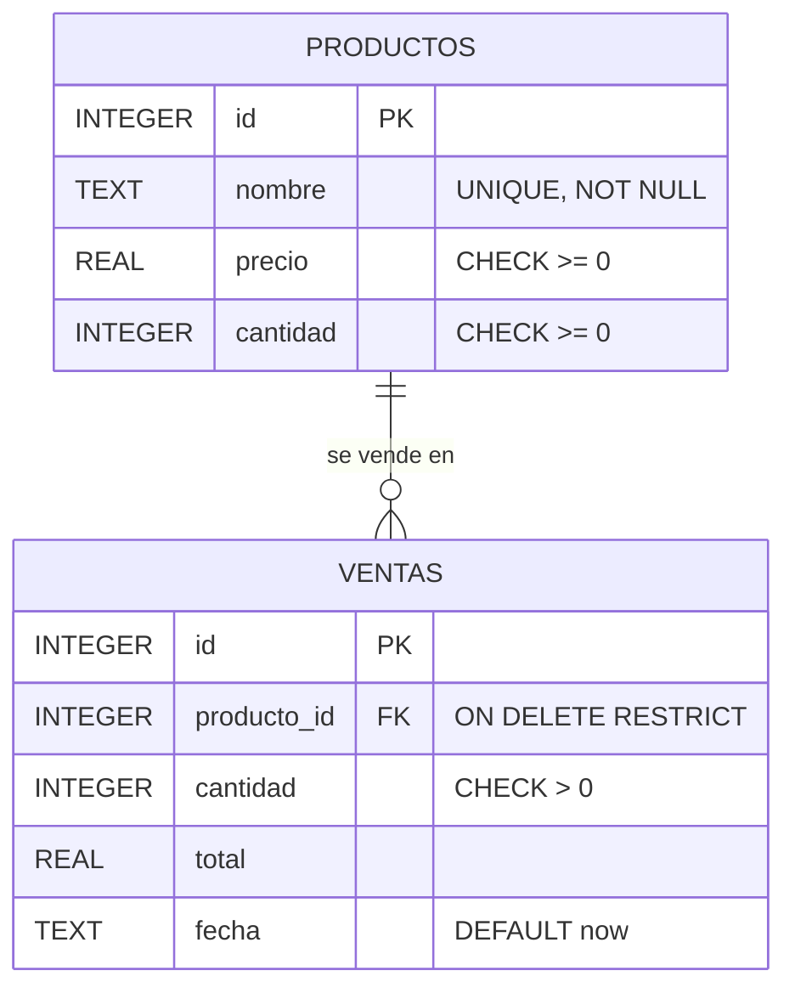
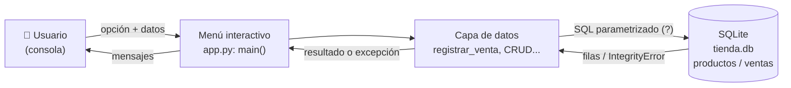
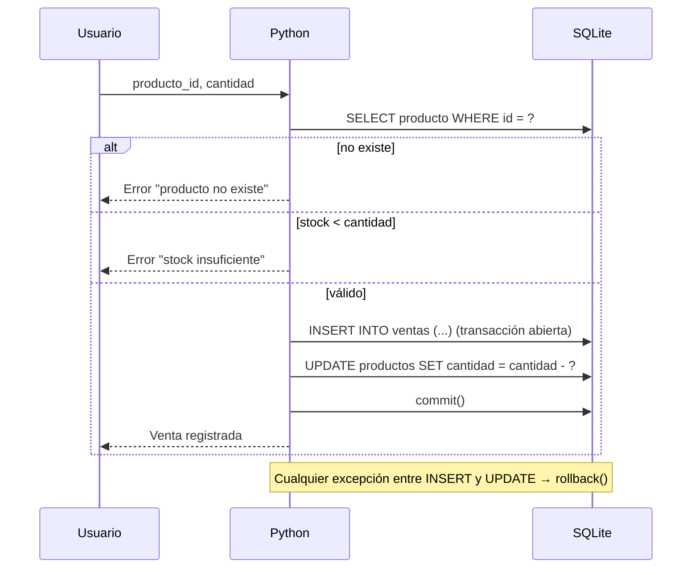
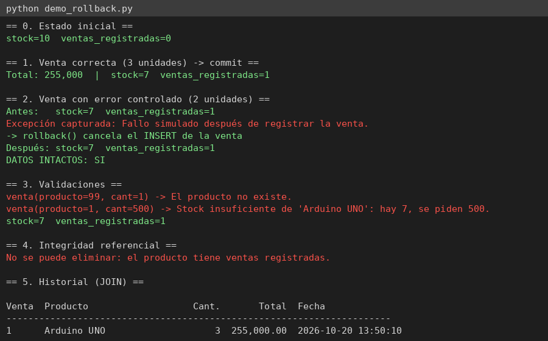
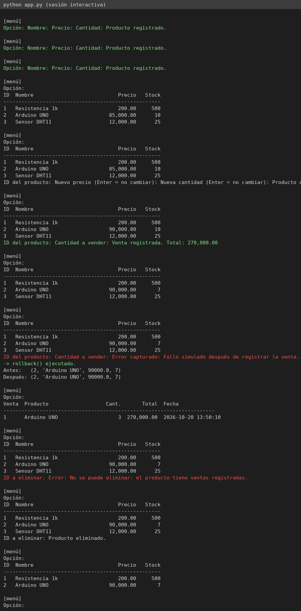

# Sistema de inventario y ventas — Parcial Acceso a Datos 2026

Aplicación de consola en **Python + SQLite** (`sqlite3`, solo librería estándar) para una tienda de componentes electrónicos. Garantiza que **venta e inventario nunca queden inconsistentes** gracias a transacciones (`commit()` / `rollback()`).

## Ejecución

```bash
python app.py            # menú interactivo (crea tienda.db y las tablas solas)
python demo_rollback.py  # demostración automática de commit, validaciones y rollback
```
Requisitos: Python 3.8+. Sin dependencias externas.

## Estructura

| Archivo | Contenido |
|---|---|
| `app.py` | Lógica de datos (CRUD, venta transaccional) + menú |
| `demo_rollback.py` | Prueba del error controlado con BD temporal |
| `evidencias/` | Capturas y salidas reales de ejecución |

---

## Parte 1. Análisis y diseño

### Entidades y atributos
| Entidad | Atributos |
|---|---|
| **Producto** | id (PK), nombre (único), precio, cantidad |
| **Venta** | id (PK), producto_id (FK), cantidad, total, fecha |

Relación: **un producto puede tener muchas ventas** (1:N).

### Modelo de datos


Decisiones: `PRAGMA foreign_keys = ON` (SQLite lo trae apagado); `ON DELETE RESTRICT` impide borrar productos con historial; los `CHECK` evitan stock o precios negativos aun si falla la validación en Python.

### Diagrama de arquitectura (Usuario ↔ Python ↔ SQLite)

```
Usuario ──► Menú (main) ──► Funciones de datos ──sqlite3──► tienda.db
   ▲             │                    │                          │
   └─ mensajes ──┘◄──── resultado / excepción ◄─────────────────┘
```

### Operaciones al registrar una venta

1. Verificar que el producto exista. 2. Comprobar stock suficiente. 3. `INSERT` en `ventas`. 4. `UPDATE` descontando el inventario. 5. `commit()`. Si algo falla: `rollback()`.

---

## Parte 2. Cómo está construido el software

- **Una función por operación** (`registrar_producto`, `listar_productos`, `actualizar_producto`, `eliminar_producto`, `registrar_venta`, `historial_ventas`): reciben la conexión y no imprimen, por eso se pueden probar sin el menú (`demo_rollback.py`).
- **Presentación separada** (`mostrar_*`, `main`): solo lee entradas, llama a la capa de datos y muestra resultados; captura `ValueError` y `sqlite3.Error`.
- **Consultas siempre parametrizadas** con `?` → sin inyección SQL.
- **Creación automática** de tablas con `CREATE TABLE IF NOT EXISTS`.
- **Historial** con `JOIN`: `ventas v JOIN productos p ON p.id = v.producto_id`.
- **Eliminar respetando relaciones**: si hay ventas, SQLite lanza `IntegrityError`; se hace `rollback()` y se informa al usuario.

## Parte 3. Transacción y reto de rollback

Python (módulo `sqlite3`) abre la transacción de forma implícita en el primer `INSERT`. En `registrar_venta`:

```python
try:
    ... validaciones ...
    conn.execute("INSERT INTO ventas ...", (...))
    if simular_error:                       # error controlado
        raise RuntimeError("Fallo simulado después de registrar la venta.")
    conn.execute("UPDATE productos SET cantidad = cantidad - ? WHERE id = ?", (...))
    conn.commit()                           # ambas operaciones se confirman juntas
except Exception:
    conn.rollback()                         # se deshace TAMBIÉN el INSERT
    raise
```

**Explicación breve:** la venta y el descuento de stock son una sola unidad lógica (atómica). Sin transacción, un fallo entre ambas dejaría una venta sin descuento (el problema de la tienda). Con `rollback()` el estado vuelve al anterior al intento.

**Demostración** (`python demo_rollback.py`, salida real en `evidencias/salida_demo.txt`):

```
== 2. Venta con error controlado (2 unidades) ==
Antes:   stock=7  ventas_registradas=1
Excepción capturada: Fallo simulado después de registrar la venta.
-> rollback() cancela el INSERT de la venta
Después: stock=7  ventas_registradas=1
DATOS INTACTOS: SI
```
También desde el menú, opción **7**.

## Evidencias de ejecución


